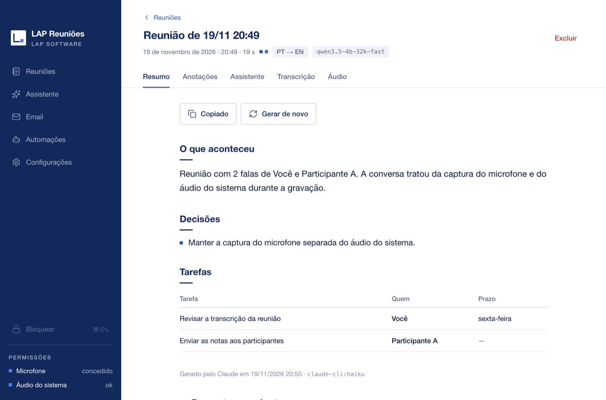
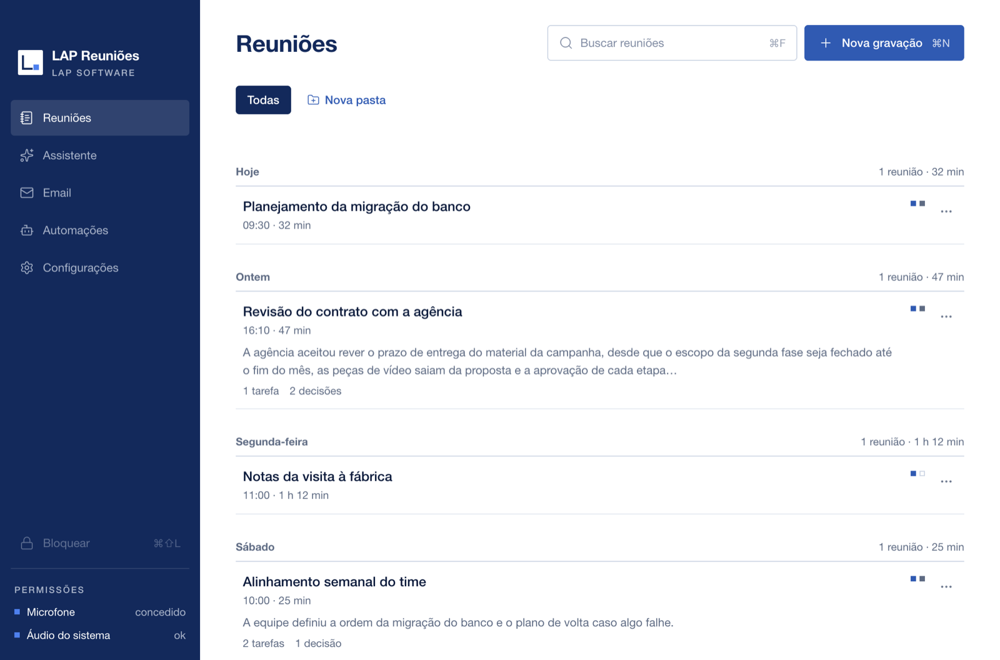
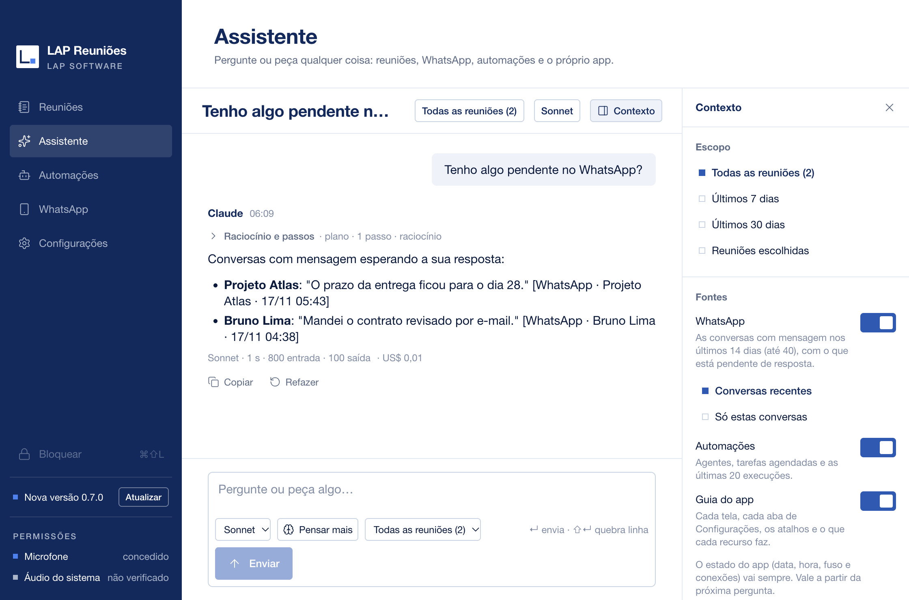
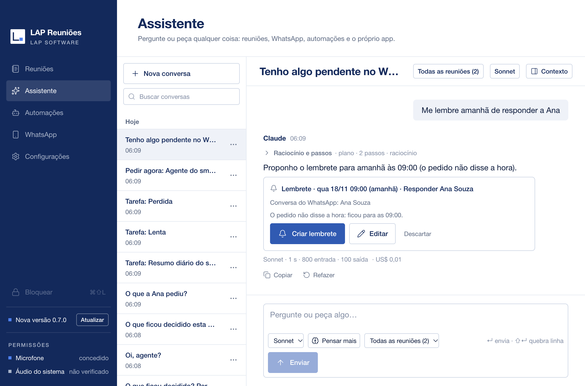
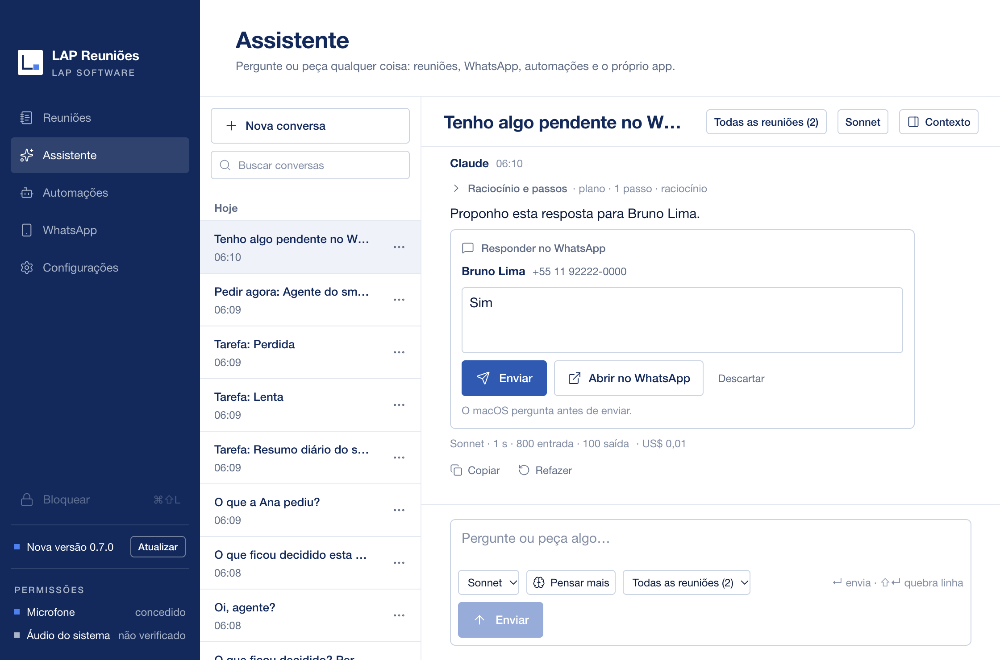
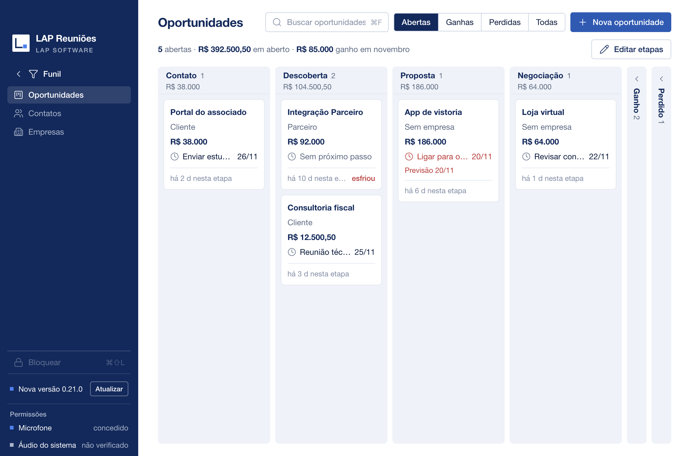
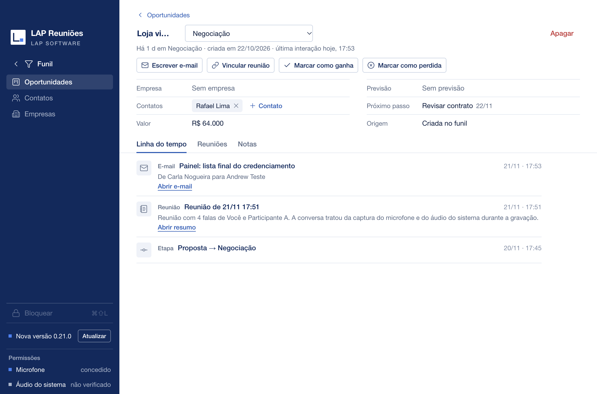
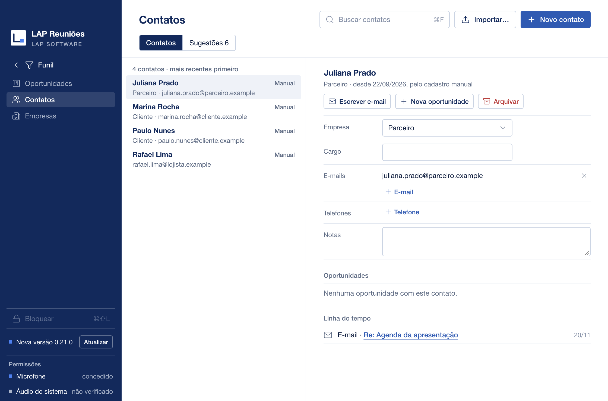
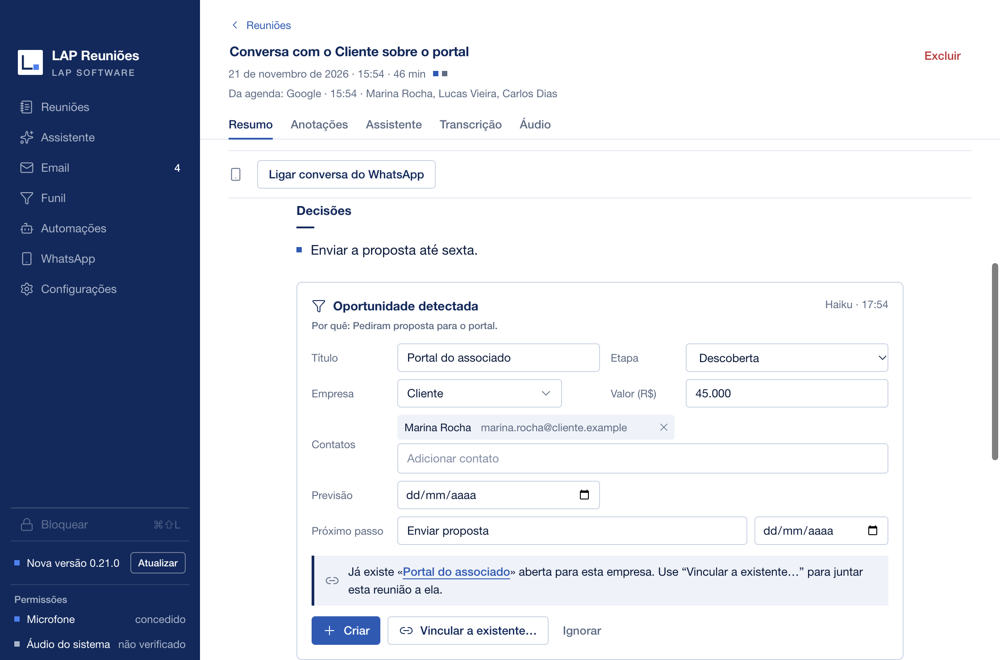

# LAP Reuniões

**Suas reuniões, transcritas, traduzidas e entendidas — com a IA que você escolher, rodando no seu Mac.**

LAP Reuniões é um app de desktop para macOS que escuta a reunião (o seu microfone e o som do Zoom, Meet, Teams ou qualquer outro app), mostra a transcrição ao vivo, traduz enquanto as pessoas falam e, no fim, entrega resumo, decisões, tarefas com responsável e um **Assistente** para perguntar qualquer coisa sobre o que foi dito (e pedir lembretes e respostas, que só saem com o seu clique). Sem bot entrando na chamada, sem driver de áudio virtual, sem mexer no app da reunião.


---

## Liberdade para escolher a sua IA

O app não prende você a um fornecedor. Cada parte do trabalho usa um motor que você escolhe em **Configurações**:

| Parte | Opções hoje | Como você escolhe |
|---|---|---|
| Transcrição ao vivo | AssemblyAI (streaming v3) | sua própria chave da AssemblyAI |
| Tradução ao vivo | 60+ modelos do LLM Gateway da AssemblyAI **ou** o Claude | Configurações › Claude › "Traduzir com" e o seletor de modelo |
| Resumo, análise e Assistente | Claude — Haiku, Sonnet ou Opus | Configurações › Claude, e por conversa no "Assistente" |
| Como o app fala com a IA | **Agente via ACP** (recomendado) ou linha de comando | Configurações › Claude › "Conexão com o Claude" |

**ACP (Agent Client Protocol)** é um protocolo aberto para apps conversarem com agentes de IA. O LAP Reuniões é um cliente ACP: ele abre o agente, entrega a pasta das reuniões e recebe de volta a resposta, o raciocínio, os passos e o plano — tudo pelo protocolo. Como o protocolo é o mesmo para vários agentes, o app foi feito com **perfis de agente**: hoje existe o do **Claude**; **Gemini CLI** e **Codex** entram como novos perfis, sem mudar o resto do app *(em breve)*.

Você usa a **sua** conta e o **seu** `claude` instalado. O app não tem servidor próprio e não cobra nada por cima.

---

## O que ele faz

### Durante a reunião
- **Transcrição ao vivo** de "Você" (microfone) e dos "Participantes" (som do sistema), lado a lado, com uma fita de volume das duas vozes.
- **Tradução ao vivo** de cada fala, logo abaixo dela.
- **Remove o eco**: sem fone, a voz dos outros vaza para o seu microfone; o app reconhece e esconde a repetição.
- **Identificar quem fala** (opcional): separa "Participante A", "B"… Desligado, as falas se dividem pelas pausas.
- **Anotações em post-its** coloridos, com a hora da reunião em cada uma (⌘⇧N).
- **"Analisar até agora"** (⌘⇧A): a qualquer momento, lê a reunião inteira até ali e devolve **perguntas em aberto**, **o que não ficou claro**, **o que confirmar** e **perguntas para fazer agora**. Cada item vira anotação com um clique. A próxima análise risca o que já foi respondido.
- Grava o **áudio** (`.m4a`) e a **transcrição** (`.md`) numa pasta do seu Mac.


### Depois da reunião
- **Resumo automático**: o que aconteceu, decisões, tarefas com quem faz e prazo, e as perguntas que ficaram em aberto. Cada tarefa do resumo tem **Adicionar**, que a leva para a lista de [Tarefas](#tarefas-tudo-o-que-você-tem-para-fazer), e "Adicionar as minhas" leva de uma vez as que ficaram com você.
- Abas **Resumo · Anotações · Assistente · Transcrição · Áudio** em cada reunião.
- Lista de reuniões **por dia**, com prévia do resumo, contagem de tarefas e **busca** sem acento nem maiúscula em títulos, transcrições, resumos e anotações.





### Assistente: pergunte ou peça qualquer coisa
A tela que antes se chamava "Perguntar".
- Pergunte "O que ficou decidido esta semana?", "Quais tarefas são minhas?", "Tenho algo pendente para responder no WhatsApp?", "Como ligo o resumo automático?".
- Além das reuniões, ele lê as suas **Tarefas** (as vencidas, as de hoje, as próximas e as sem prazo), o **WhatsApp** (as conversas dos últimos 14 dias, com o que está pendente de resposta, ou só as que você escolher), as **Automações** (agentes, agendamentos e as últimas execuções), o **guia do próprio app**, a **internet** (busca na web quando a pergunta pedir, com os links na resposta) e o estado atual (data, hora, contas). Cada fonte tem um interruptor no painel **Contexto**.
- Peça ações na mesma tela: "me lembre amanhã de responder a Ana", "responda a Bia dizendo sim", "toda segunda, me mande o resumo da semana". O Assistente **propõe** um cartão (lembrete, tarefa, resposta no WhatsApp com o texto editável, agendamento ou um botão para abrir uma tela) e **nada acontece sem o seu clique**. Os lembretes viram tarefas com aviso, na tela Tarefas, e chegam como notificação do macOS.
- Você **vê o Claude pensar**: os passos ("Lendo o índice das reuniões", "Abrindo «Planejamento»", "Lendo as conversas do WhatsApp") e o raciocínio aparecem enquanto ele trabalha.
- Cada resposta cita de onde veio cada coisa (a reunião com link, "[Tarefa · Mandar a proposta]", "[WhatsApp · Ana · 16/11 14:46]", "[Automações · Resumo da semana]", "[Guia]", "[Web · site · título]" com o link, que abre no navegador) e mostra **modelo, tempo, tokens e custo** e, quando buscou na web, "Usou a internet · N buscas · M páginas".
- **Agentes e agendamentos com internet**: em Automações, cada agente tem o interruptor "Pode pesquisar na internet" (desligado por padrão). "Pedir agora" e os agendamentos usam o que está no agente.
- Painel **Contexto**: todas as reuniões, últimos 7 ou 30 dias, ou só as que você escolher; as fontes; modelo por conversa; "Pensar mais".







### Email: IMAP, POP3 e SMTP

- Qualquer conta de email que fale **IMAP ou POP3** para receber e **SMTP** para enviar. Você digita o endereço e a senha, e o app descobre os servidores sozinho: tem presets para Gmail, Outlook, Yahoo, iCloud, Zoho, UOL, BOL e Terra; para os outros domínios consulta o [banco aberto do Thunderbird](https://autoconfig.thunderbird.net/) e, em paralelo, o MX do domínio no DNS, que reconhece domínio próprio hospedado na Zoho (`imappro`/`smtppro`), no Google Workspace ou no Microsoft 365. Se não achar, há a "Configuração avançada" para preencher na mão. Nenhum registro de app nem login de terceiros é exigido.
- As contas aparecem no **menu lateral**, cada uma com a Caixa de Entrada, os Enviados e, nas contas IMAP, a árvore de pastas do servidor (criar, renomear e apagar pasta pelo clique direito). A tela segue o desenho do Outlook para desktop: lista de mensagens de um lado e leitura do outro, com Responder, Responder a todos, Encaminhar, Marcar, Apagar e Mover (arrastando para uma pasta, por "Mover para…" ou com várias mensagens escolhidas). Dá para mandar e baixar anexos, e o encaminhar leva os anexos da mensagem original. Cada conta tem **assinatura** e **regras** (mover, marcar como lida, apagar, não avisar) que agem no email que chega com o app aberto. Os **convites de reunião** viram um cartão na leitura, com Aceitar, Talvez e Recusar e a opção de pôr o evento no Calendário do Mac.
- O **Painel** é o topo do Email: o clique em Email leva a ele. Mostra as contas com os não lidos e os pendentes e três cartões: **Precisam de atenção** (os e-mails mais importantes, com o motivo), **Respostas sugeridas** (um rascunho por e-mail, com "Abrir no Composer" e "Ignorar") e **Sugestões de organização** (grupos "Mover para <pasta>", com "Mover", "Mover todos" e "Ignorar"). Ele só sugere: **nada é enviado nem movido sem o seu clique**; a resposta abre no Composer para você revisar e enviar, e o que foi movido pelo Painel tem Desfazer. A análise usa o **Haiku** por padrão, roda uma vez por dia com o app aberto e quando você clica em "Analisar agora"; o interruptor "Analisar e-mails com IA" e o modelo (Haiku ou Sonnet) ficam em Configurações › Email › Painel. Desligada, o Painel mostra só os não lidos pendentes e nada vai ao modelo.
- **Privacidade do Painel:** com a análise ligada, o remetente, o assunto e uma prévia de até 1.500 caracteres de cada e-mail recebido nos últimos 7 dias vão ao modelo do Claude; o resultado fica só neste Mac. Nenhum assunto, remetente, prévia ou resposta vai para o log.
- Para o Assistente **organizar a Caixa de Entrada** em pastas, é preciso pedir no chat ("organiza meus emails em resolvidos e pendentes"); ele mostra o andamento e o que moveu tem Desfazer.
- O HTML do email é limpo antes de aparecer: script, formulário e iframe nunca rodam. As imagens de fora só carregam no clique em "Carregar imagens", e nunca de endereços da sua rede local.
- O **Assistente** lê os emails: "o que tenho de email pendente?", "acha o email do contador de março", inclusive em pastas antigas do servidor (só leitura, sem marcar como lido). Ele também propõe resposta num cartão, que **só sai no seu clique em "Enviar"**, e cria lembrete ligado ao email.
- **Agendamentos podem enviar sozinhos** se você permitir antes: no agendamento, ligue "Pode enviar email" e escolha a conta, a lista de destinatários permitidos (endereços ou `@empresa.com`) e um limite por execução. Tudo o que sair aparece em Execuções e em Enviados, e desligar a seção corta na hora. Envio para fora da lista é recusado, mesmo que um email lido pelo agendamento peça outra coisa.

**Gmail:** o Google não aceita a senha normal por IMAP. Use uma **senha de app**:
1. Ligue a verificação em duas etapas na sua [Conta do Google](https://myaccount.google.com/security).
2. Abra [Senhas de app](https://myaccount.google.com/apppasswords), dê um nome (por exemplo, "LAP Reuniões") e copie a senha de 16 letras.
3. No app, em Configurações › Email › Adicionar conta, digite o seu `@gmail.com` e cole essa senha.

**Outlook, Hotmail e Live pessoais** ainda não funcionam: a Microsoft só aceita login moderno (OAuth) por IMAP, e isso exigiria registrar o app numa conta da Microsoft. Exchange e Microsoft 365 também ficam para depois.

### Funil de vendas: contatos, empresas e oportunidades

O funil de quem vende sozinho, ligado ao que o app já guarda: as reuniões, os emails e o WhatsApp. **Funil**, na barra lateral entre Email e Redes, abre as telas Oportunidades, Contatos e Empresas.

- **Durante e depois da reunião**: quando o resumo termina, o app lê o que foi dito e, se a conversa foi de venda, mostra no Resumo o cartão **"Oportunidade detectada"** (ou "Atualizar oportunidade", quando já existe uma aberta), com título, empresa, contatos, etapa, valor, previsão e próximo passo (que vira uma tarefa ligada à oportunidade) já preenchidos e editáveis. **Criar** (ou Atualizar), **Vincular a existente…** e **Ignorar**: nada entra no funil sem o seu clique. "Detectar oportunidade", ao lado de "Copiar resumo", roda a leitura sob demanda, mesmo com a detecção automática desligada. No mesmo Resumo, o bloco **Participantes** mostra quem estava no convite da agenda, com o contato ligado ou o botão "+ Contato".
- **Contatos**: a lista com a ficha de cada um (empresa, cargo, emails, telefones, notas, as oportunidades e a linha do tempo com as reuniões, os emails e as conversas do WhatsApp dessa pessoa). **Importar…** traz uma planilha **CSV** ou um arquivo **vCard** (.vcf): o app reconhece as colunas sozinho, mostra a prévia para conferir e junta quem já existe pelo email ou pelo telefone, sem repetir. A aba **Sugestões** lista quem apareceu nas reuniões, quem trocou dois ou mais emails com você nos últimos 90 dias e as conversas recentes do WhatsApp, cada um com **Adicionar** e **Ignorar**. O "+ Contato" também aparece ao lado do remetente na leitura de um email e no topo dos Detalhes de uma conversa do WhatsApp.
- **Empresas**: a lista com a ficha (domínios, site, notas, os contatos e as oportunidades). O contato com email de um domínio da empresa entra nela sozinho; com um domínio novo, a ficha sugere criar a empresa.
- **Oportunidades em kanban**: uma coluna por etapa (Contato, Descoberta, Proposta e Negociação, mais Ganho e Perdido, que ficam recolhidos numa faixa estreita), cada uma com a contagem e a soma dos valores, e no topo quantas estão abertas, o valor em aberto e o ganho no mês. Para mudar de etapa, **arraste o cartão**; soltar em Perdido pede o **motivo da perda** no próprio cartão. Cada cartão mostra o valor, o próximo passo, que é a **próxima tarefa aberta** da oportunidade, com o prazo (em vermelho quando venceu; "Sem tarefa" quando não há nenhuma), e o aviso **"esfriou"** quando a oportunidade ficou parada mais dias do que o combinado. "Nova oportunidade" abre um cartão no topo da primeira coluna, e "Editar etapas" renomeia, reordena, cria e apaga etapas.
- **Detalhe da oportunidade**: os campos editáveis no lugar, a etapa, Escrever e-mail, Abrir WhatsApp, Vincular reunião, Marcar como ganha ou perdida, a seção **Tarefas** (as abertas, a primeira é o próximo passo do quadro, "Nova tarefa" e as feitas recolhidas) e as abas **Linha do tempo** (reuniões, emails, conversas, tarefas criadas e concluídas e cada mudança, do mais novo para o mais antigo), Reuniões e Notas. A fechada pode ser arquivada: sai do quadro e continua na ficha do contato.
- **Assistente**: com a fonte **Funil** ligada no Contexto (ela vem desligada, porque leva ao Claude os nomes, os emails e os telefones dos contatos), pergunte "o que está esfriando?" ou "como está o funil?". Ele cita cada oportunidade como "[Funil · título]" e propõe cartões para criar uma oportunidade, mover de etapa, definir o próximo passo (que cria a tarefa na oportunidade) ou criar um contato, que só valem no seu clique.
- **Automações**: cada agente tem o interruptor **"Pode ler o funil"** (desligado por padrão), para "Pedir agora" e os agendamentos usarem as oportunidades e os contatos.
- **Aviso Hoje**: as oportunidades que esfriaram entram no aviso diário das tarefas ("Funil: N esfriadas"); veja [Tarefas](#tarefas-tudo-o-que-você-tem-para-fazer).
- **Configurações › Geral › Funil de vendas**: "Detectar oportunidades nas reuniões", "Considerar esfriada após (dias)" (padrão 7; uma tarefa concluída também conta como conversa) e "Incluir oportunidades esfriadas no aviso Hoje".
- **Onde ficam os dados**: num arquivo só, `funil.json`, na pasta de dados do app, só neste Mac, com uma cópia por dia dos últimos 7 dias.









### Tarefas: tudo o que você tem para fazer

Uma lista só, guardada no seu Mac, com o que sai das reuniões, das oportunidades, dos emails, do WhatsApp e do Assistente, cada tarefa ligada de volta à origem. **Tarefas**, na barra lateral logo abaixo de Reuniões, mostra ao lado o número de tarefas vencidas. Nada entra na lista sem o seu clique.

- **Hoje · Próximas · Todas · Feitas · Sugestões**: Hoje (a aba de abertura) traz as vencidas, em vermelho com "há N d", e depois as de hoje; Próximas, as com prazo depois de hoje; Todas, as abertas, com as sem prazo no fim; Feitas, as concluídas e canceladas dos últimos 90 dias. "Agrupar por" junta a lista por prazo, oportunidade, reunião ou contato, e a busca (⌘F) procura no título, no detalhe e na origem.
- **Cada linha** tem a caixa de feito (um clique conclui, outro reabre), o título, a origem ("Reunião: …", "Oportunidade: …", "E-mail: …", "WhatsApp: …"), o responsável quando não é você, a estrela das importantes e o prazo. O clique abre o **detalhe ao lado**, sem janela por cima: prazo, lembrete, responsável (você, um contato do funil ou outra pessoa), importante, detalhe, os vínculos (oportunidade, contatos, reunião, "Abrir e-mail", "Abrir conversa") e o histórico de cada mudança.
- **Nova tarefa** (⌘⇧T, de qualquer tela) abre o formulário no topo da lista: título, prazo e, se quiser, a oportunidade. Enter cria.
- **De onde nascem**: no **Resumo** da reunião (Adicionar em cada linha e "Adicionar as minhas"; a linha passa a mostrar a caixa de feito); na **oportunidade** e nas fichas de **contato** e **empresa** ("Nova tarefa", já ligada); na leitura de um **email** e nos Detalhes de uma conversa do **WhatsApp** ("+ Tarefa", ligada ao email ou à conversa e ao contato); e no **Assistente** ("crie a tarefa…", "conclua…", "adie…", sempre num cartão que você confirma).
- **Sugestões**: o que ficou com você nas reuniões e conversas dos últimos 30 dias e ainda não virou tarefa (as tarefas do resumo com "Você", o que a análise deixou para você confirmar e as pendências e compromissos do WhatsApp), com **Adicionar** e **Ignorar**.
- **Próximo passo da oportunidade**: é a próxima tarefa aberta ligada a ela, a de prazo mais perto. Concluir uma passa o quadro para a seguinte.
- **Lembretes**: toda tarefa com prazo ganha um aviso no dia, às 9h (a hora muda nas Configurações), que você troca ou tira em cada uma. Sai a notificação "Tarefa" com o título e "Abrir". Os lembretes que você pede ao Assistente ("me lembra de ligar para o Paulo amanhã às 10h") também viram tarefas com aviso.
- **Aviso Hoje**: uma notificação por dia, na hora do lembrete, com "N vencidas · M para hoje" e, se você quiser, "Funil: X esfriadas". Sem nada a dizer, não avisa. O clique abre Tarefas.
- **Automações**: o que roda num horário passou a se chamar **Agendamentos** (e o cartão do Assistente que abre o formulário, "agendamento"), para não confundir com as tarefas. Cada agente tem o interruptor **"Pode ler as tarefas"** (desligado por padrão), e o modelo de agente "Minhas tarefas" já vem com ele ligado.
- **Configurações › Geral › Tarefas**: "Hora do lembrete" (padrão 09:00), "Lembrar no prazo", "Aviso diário Hoje" e "Sugerir tarefas das reuniões".
- **Onde ficam os dados**: num arquivo só, `tarefas.json`, na pasta de dados do app, só neste Mac, com uma cópia por dia dos últimos 7 dias. Na primeira abertura desta versão, o app leva para a lista, uma única vez, o próximo passo de cada oportunidade aberta e os lembretes ainda por vir, e guarda antes uma cópia do funil e das Automações (`funil.json.bak-tarefas-<dia>` e `schedules.json.bak-tarefas-<dia>`).

### Início: o seu dia numa tela

A primeira tela da barra lateral e a que aparece ao abrir o app: o que tem na agenda, o que vence hoje e o que ficou sem resposta, num lugar só. **Só mostra**: toda ação é um clique seu (concluir uma tarefa, abrir uma tela, começar a transcrição), e nada é enviado, aceito ou mudado a partir dela.

- **Agenda de hoje**: os eventos do dia das agendas Google e Microsoft conectadas e do **Calendário do Mac**, numa linha do tempo com "livre até" entre eles e a marca "agora". O mesmo evento em duas agendas aparece uma vez só, com as duas etiquetas. O evento em andamento ganha **Transcrever** (o mesmo do aviso da agenda) e o já gravado, o link para a reunião. No pé, "Amanhã: N eventos". O Início nunca cria, edita ou apaga evento. Sem o acesso ao Calendário do Mac, a linha "Calendário do Mac sem acesso — conceder" pede o acesso ao macOS.
- **Tarefas**: as vencidas em destaque e até 6 de hoje, com a caixa de concluir.
- **Pendências**, só quando há: conversas do WhatsApp sem resposta, convites da agenda sem resposta e os emails da pasta Pendentes.
- **Última reunião** (com a primeira frase do resumo) e **Automações** (a próxima execução e o aviso quando a última falhou).
- Só lê o que você já conectou: nenhuma rede nova, nada guardado além da preferência. Fonte desligada não aparece.
- **Configurações › Geral › Início**: a tela inicial (Início ou Reuniões) e quais blocos aparecem.

### Redes: Instagram

- **Conta por token**: em Configurações › Contas › Instagram, cole o token de acesso gerado no painel da Meta (app do tipo Business com o produto Instagram, a sua conta como testadora). Vale para conta profissional (Business ou Creator), sem Página do Facebook e sem login de terceiros. O app confere o token, mostra a conta (tipo, seguidores, validade) e renova o token sozinho antes dos 60 dias. Dá para conectar mais de uma conta.
- **Armazenamento de mídia (S3)**: o Instagram só aceita imagem por um endereço público, então imagens e carrosséis sobem antes para um bucket seu (Amazon S3, Cloudflare R2 ou qualquer S3), configurado em Configurações › Contas, com "Testar". O arquivo sai do bucket depois que o Instagram publica. Vídeo e Reels vão direto para a Meta e não precisam dele.
- **Publicações**: a fila de cada conta (com erro, rascunhos, agendadas, publicadas) e o editor ao lado: imagem, carrossel de até 10 ou Reels, conferidos pelas regras do Instagram antes de entrar; legenda com contador de 2.200 caracteres, hashtags e @; texto alternativo; agendamento. A agendada sai na hora com o app aberto (com o app fechado, na próxima abertura), e nada sai duas vezes.
- **Comentários**: os das 25 publicações mais recentes, agrupados por publicação, com responder, ocultar e excluir. Os não lidos aparecem na barra lateral.
- **Mensagens**: as conversas diretas e a resposta pela tela, com o aviso da janela de 24 h do Instagram.
- **Métricas**: alcance, visualizações, interações, seguidores ganhos e perdidos e mais, em 7, 28 ou 90 dias, e a tabela das 25 publicações mais recentes, ordenável.
- **Assistente**: com a fonte "Redes" ligada no Contexto, ele lê as publicações, as métricas e o que está sem resposta, escreve posts a partir das reuniões e propõe o cartão "Rascunho para o Instagram". "Criar rascunho" põe na fila; publicar é sempre com você, na tela Redes.

### Conexões: servidores MCP e conectores do claude.ai
- Em **Configurações › Conexões**, servidores MCP (os do Claude CLI, os só do app e os importados do Claude Desktop) dão ao Assistente ferramentas de outros sistemas. Tudo começa desligado. Cada ferramenta tem uma regra: **Perguntar** (o padrão), Permitir ou Negar. Com "Perguntar", a conversa mostra um cartão com os argumentos, e sem resposta em 2 minutos o app nega.
- **Conectores do claude.ai** (Notion, Google Drive, Gmail…): a última seção da aba lista os conectores da sua conta (lidos do `claude mcp list`). Todos ficam **desligados por padrão**, inclusive um conector novo que aparecer na conta depois: o agente só usa o que você ligar, um por um. Ligado, o conector vale no Assistente e no chat da reunião a partir da próxima pergunta; tradução, resumo, análise e Automações nunca usam conector.
- "Ver ferramentas" lista as ferramentas do conector (do próprio `claude`, sem perguntar nada ao modelo), cada uma começando em Perguntar. O rótulo "Escrita" marca as que têm nome de escrita (send, create, delete, update), sem mudar a regra.
- O login de cada conector fica no claude.ai: o app não vê nem guarda token. Conector em "Precisa autorizar" mostra o link para [claude.ai/settings/connectors](https://claude.ai/settings/connectors).
- **Os conectores só funcionam com o Claude logado pela assinatura.** Com chave de API ou outro provedor, a seção mostra só esse aviso.

### Do seu jeito
- **Configurações em abas** (Geral, Gravação, Claude, Arquivos, Contas, Email, Plugins, Conexões, Sobre) com busca (⌘F). As abas ficam na barra lateral, e ⌘1 a ⌘9 trocam de aba com Configurações aberta.
- **Barra lateral em dois níveis**, como os Ajustes do iOS: na raiz, Reuniões, Tarefas (com o número de vencidas), Assistente, Email (com o total de não lidas), Funil, Redes (com uma conta do Instagram conectada), Automações, WhatsApp e Configurações. Email, Funil, Redes, Configurações e Assistente têm nível próprio, que entra deslizando com as contas e pastas, as telas do funil, as contas e seções, as abas ou as conversas. O cabeçalho no topo do nível volta ao menu sem trocar a tela aberta.
- **Sua marca**: troque o nome e o logo do app.
- Tema claro, escuro ou do sistema.
- **Atualização pelo GitHub**: o app avisa quando sai versão nova, baixa, confere o arquivo e abre o instalador.


---

## Como funciona

```
Microfone ─┐                                   ┌─> transcrição ao vivo
           ├─> AssemblyAI (streaming) ─> texto ┤
Som do Mac ┘   (Core Audio Tap, sem driver)    └─> tradução ao vivo (AssemblyAI ou Claude)

Reuniões em Markdown no seu Mac ─> agente de IA via ACP ─> resumo · análise · Assistente
          (só leitura, presa à pasta)       (Claude hoje; Gemini/Codex em breve)
```

1. **Captura**: o próprio Chromium do app captura o som do sistema pelo Core Audio Tap do macOS — nada de driver virtual e nenhuma interferência no app da reunião.
2. **Transcrição**: o áudio vai para a AssemblyAI, que devolve o texto palavra por palavra.
3. **Tradução**: cada fala final é traduzida pelo modelo escolhido.
4. **Acervo**: cada reunião vira um arquivo Markdown (índice + reuniões) numa pasta privada do app.
5. **Agente**: para resumir, analisar ou responder, o app abre o agente via ACP **preso a essa pasta**, só com ferramentas de **leitura e busca**. O app aprova cada pedido de ferramenta e nega o resto.

---

## Privacidade e segurança

| O quê | Para onde vai |
|---|---|
| Áudio da reunião | só para a AssemblyAI, durante a gravação |
| Áudio do WhatsApp que você manda transcrever | só para a AssemblyAI (`api.assemblyai.com`), no clique em "Transcrever" |
| Emails | ficam no seu Mac; só falam com os servidores IMAP, POP3 e SMTP da sua conta. Para descobrir os servidores, só o domínio vai ao Thunderbird |
| Senha do email | cifrada pelo Chaveiro do macOS (`safeStorage`) |
| Texto da reunião | só para o agente de IA local que você escolheu (com a sua conta) |
| Arquivos (áudio, transcrição, resumo, anotações) | ficam no seu Mac |
| Chaves e tokens | cifrados pelo Chaveiro do macOS |
| Instagram | o app só fala com `graph.instagram.com` e `rupload.facebook.com`, e só baixa as miniaturas dos servidores de imagem da Meta (`*.cdninstagram.com`, `*.fbcdn.net`, só JPEG). O token e a chave secreta do S3 ficam cifrados pelo Chaveiro do macOS |
| Funil (contatos, empresas, oportunidades) | ficam no seu Mac, em `funil.json`; só vão ao Claude com a fonte "Funil" ligada no Assistente ou com "Pode ler o funil" ligado no agente |
| Tarefas | ficam no seu Mac, em `tarefas.json`; só vão ao Claude com a fonte "Tarefas" ligada no Assistente (vem ligada) ou com "Pode ler as tarefas" ligado no agente |
| Imagens a publicar | só para o bucket S3 que você configurou, de onde saem depois que o Instagram publica |

O agente **não escreve arquivos, não roda comandos e só usa os servidores MCP e os conectores do claude.ai que você ligar**, com a regra de cada ferramenta. A internet só entra onde você liga (a fonte "Internet" do Assistente e o "Pode pesquisar na internet" de cada agente): a busca é livre (até 10 por pedido), mas o app só deixa abrir uma página cujo endereço veio de um resultado dessa busca ou foi escrito por você (até 15 por pedido). Um endereço montado pelo agente, que poderia levar trechos das suas reuniões para fora, é recusado. Tradução, resumo e análise nunca acessam a internet. Nada é publicado, respondido, ocultado ou excluído no Instagram sem o seu clique na tela Redes: o Assistente só cria rascunho. Ele roda sem as suas configurações pessoais do Claude (hooks, `CLAUDE.md`, permissões globais) e só lê dentro da pasta das reuniões — o app confere cada pedido e o próprio `claude` recebe `--restricted`. O agente oficial do Claude (que tem licença proprietária da Anthropic) **não vem dentro do instalador**: o app baixa do registro do npm na primeira vez, só com o seu clique, conferindo o hash de cada pacote.

Avise as pessoas antes de gravar uma reunião.

---

## Instalar

1. Baixe o `LAP-Reunioes-<versão>-arm64.dmg` em [Releases](https://github.com/andrewjpb/meeting-scribe/releases/latest).
2. Abra e arraste o **LAP Reuniões** para Aplicativos.
3. Na primeira vez, clique com o botão direito no app → **Abrir** (o app não é assinado pela Apple).
4. Permita o **Microfone** e a **Gravação de Áudio do Sistema**.
5. Em Configurações › Gravação, cole a sua chave da [AssemblyAI](https://www.assemblyai.com/).
6. Em Configurações › Claude, clique em **Instalar** no "Agente do Claude" (precisa do [Claude Code](https://docs.claude.com/en/docs/claude-code) instalado e com login).

Depois disso, as versões novas chegam pelo próprio app.

**Requisitos:** macOS 14.4 ou mais novo, Apple Silicon (M1 ou mais novo).

---

## Experimental

### WhatsApp pessoal (por sua conta e risco)

> Este recurso usa um cliente não oficial do WhatsApp (neonize/whatsmeow). O WhatsApp pode suspender ou bloquear o seu número, de forma temporária ou definitiva, sem aviso. A LAP não tem como desfazer um bloqueio. Use por sua conta e risco.

Desligado por padrão. Em Configurações › Contas › WhatsApp, depois de aceitar o aviso, o app instala um serviço pequeno em Python neste Mac (precisa do Python 3.10 ou mais novo e da `libmagic`: `brew install python libmagic`), liga, mostra o aviso de novo e o QR code para conectar como um aparelho. A tela **WhatsApp** lista as conversas e mensagens (áudio, imagem e vídeo só baixam no clique em "Baixar": o áudio toca no próprio balão e pode ser transcrito pela AssemblyAI no clique em "Transcrever"); o **Assistente** lê as conversas recentes (ou só as que você escolher) junto com as reuniões e pode propor uma resposta num cartão; e o **Rascunho com o Claude** escreve uma resposta no campo. **Nenhuma mensagem sai sem o seu clique em "Enviar"**, com uma exceção: as conversas que você marcar para um agente de atendimento responder sozinho (abaixo). Fora delas, o Claude e os agentes só leem, escrevem rascunhos e propõem. A sessão e as mensagens ficam só no Mac. Detalhes em [`services/whatsapp-bridge/`](services/whatsapp-bridge/README.md).

### Atendimento no WhatsApp (por sua conta e risco)

Agentes com as regras que você escreve respondem as conversas do WhatsApp que você marcar, uma a uma. Crie o agente em Automações › Atendimento (o "Testar" mostra a resposta que ele daria, sem enviar nada) e marque a conversa pelo botão **Atendimento**, no topo dela. Cada conversa tem as próprias opções: o agente; o modo, **Rascunho para eu aprovar** (o padrão: o agente propõe e quem envia é você) ou **Responder sozinho**; o atraso de X a Y minutos antes de responder; o "digitando…"; o horário de atendimento; o limite de respostas por hora; e a pausa quando você responde. "Pausar todos os atendimentos", na lista de conversas, para tudo com um clique, e o histórico em Automações › Atendimento mostra o que cada agente fez, sem o texto das mensagens.

- Só funciona com o app aberto e o Mac acordado.
- Continua respondendo com o app bloqueado. Para interromper, use "Pausar todos os atendimentos".
- Não vale para grupos, e o agente não lê áudio, imagem nem arquivo: quando chega um, ele passa a conversa para você.
- Responder sozinho aumenta a chance de o WhatsApp suspender ou bloquear o seu número. O app mostra o aviso antes do primeiro atendimento automático.
- O agente não tem ferramentas e não lê nada além daquela conversa. Fora das regras, ou quando perguntam se é um robô, ele passa a conversa para você, com uma notificação.

---

## Em breve

- **Agendas Google e Microsoft**: aviso 5 min antes da reunião, aviso quando a reunião começou e não está sendo gravada ou foi cancelada, título e participantes vindos do evento.
- **Google Drive**: áudio, transcrição e resumo guardados numa pasta do seu Drive.
- **Vídeo da reunião**: peça ao Claude (Opus ou Fable) um vídeo com os principais pontos; o app monta e grava o MP4.
- **Gemini CLI e Codex** como agentes ACP.

---

## Para desenvolvedores

```bash
pnpm install
pnpm --filter @meeting-scribe/desktop dev            # desenvolvimento
bash apps/desktop/scripts/gates.sh                    # typecheck, lint, testes, build, smoke, regras visuais
SMOKE_NO_SANDBOX=1 bash apps/desktop/scripts/gates.sh # em shells que não deixam o Chromium montar o sandbox
pnpm --filter @meeting-scribe/desktop pack            # apps/desktop/dist/LAP-Reunioes-<versão>-arm64.dmg + .sha256
```

Stack: Electron 45, React 19, TypeScript, Tailwind 4, zod, Vitest, ACP (`@agentclientprotocol/sdk`). Cada etapa do produto tem um contrato verificável em `docs/specs/desktop-shell/contracts/`, e o smoke tira os prints das telas em claro e escuro.

### Publicar uma versão

```bash
bash apps/desktop/scripts/release.sh 0.4.0
```

O script confere a árvore limpa e a branch `main`, roda os gates, sobe a versão, monta o `.dmg`, faz o commit "versão X" e a tag local e escreve um rascunho de notas em `apps/desktop/dist/notas-vX.md`. Ele não publica: no fim mostra os comandos para rodar depois de revisar as notas:

```bash
git push origin main v0.4.0
cd apps/desktop && gh release create v0.4.0 dist/*.dmg dist/*.sha256 --title "LAP Reuniões 0.4.0" --notes-file dist/notas-v0.4.0.md
```

Se o script falhar no meio, ele volta a versão no `package.json`. Se o commit já tiver sido feito e a tag não, termine com `git tag vX` ou desfaça com `git reset --hard HEAD~1`.

### Estrutura

- `apps/desktop/` — o app (main, preload, renderer, testes, smoke).
- `apps/desktop/src/main/redes/` e `apps/desktop/src/renderer/src/features/redes/` — Redes (Instagram): cliente da API, S3 com assinatura SigV4, fila e agendador no main; a tela e o editor no renderer.
- `services/whatsapp-bridge/` — o serviço local do WhatsApp (experimental), com os testes em pytest.
- `docs/specs/desktop-shell/` — spec, design e contratos de cada etapa.
- `docs/fase0.md` — prova técnica (captura de áudio, provedores).
- `docs/images/` — prints usados neste README.
- `prova/` — app mínimo da prova técnica.

---

## Licença

[GPL-3.0-or-later](LICENSE) © LAP Software. Você pode usar, estudar, mudar e redistribuir o app. Quem distribuir uma versão modificada precisa mantê-la aberta, sob a mesma licença. Até a 0.15.0 o projeto era MIT, e quem já recebeu essas versões continua com os termos da MIT. O agente do Claude e o Claude Agent SDK, baixados pelo app na primeira vez, têm licenças próprias da Anthropic e dos seus autores. O neonize (Apache-2.0) e o whatsmeow (MPL-2.0), instalados pelo app só se você ligar o WhatsApp, também.
