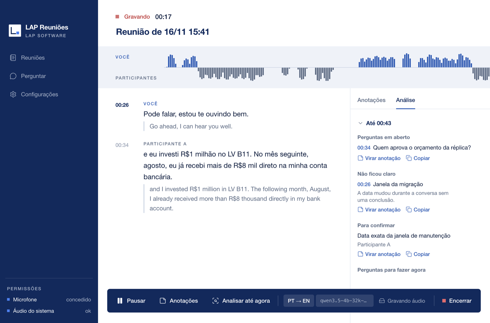
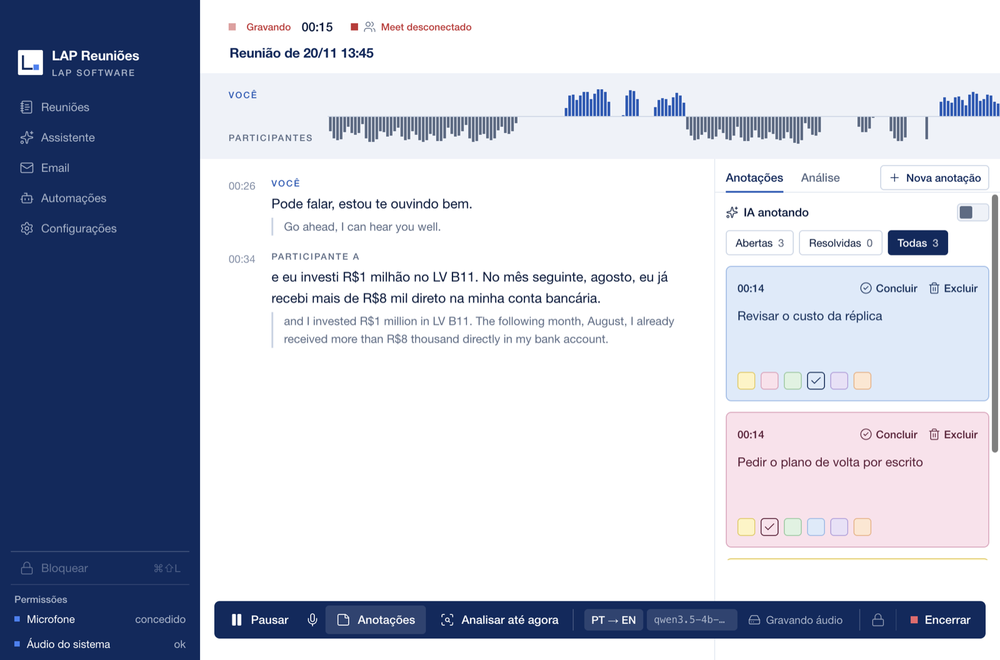
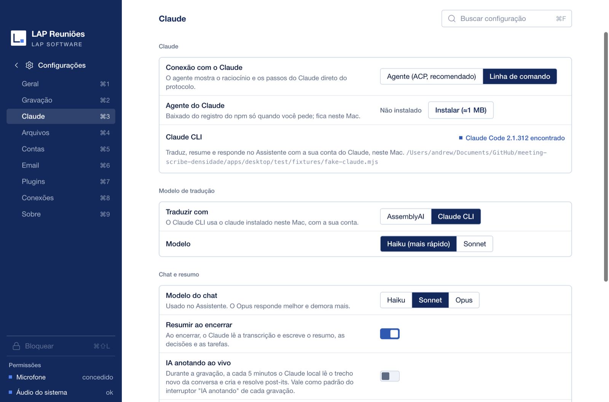

# LAP Reuniões

**Suas reuniões, transcritas, traduzidas e entendidas — com a IA que você escolher, rodando no seu Mac.**

LAP Reuniões é um app de desktop para macOS que escuta a reunião (o seu microfone e o som do Zoom, Meet, Teams ou qualquer outro app), mostra a transcrição ao vivo, traduz enquanto as pessoas falam e, no fim, entrega resumo, decisões, tarefas com responsável e um **Assistente** para perguntar qualquer coisa sobre o que foi dito (e pedir lembretes e respostas, que só saem com o seu clique). Sem bot entrando na chamada, sem driver de áudio virtual, sem mexer no app da reunião.



---

## Liberdade para escolher a sua IA

O app não prende você a um fornecedor. Cada parte do trabalho usa um motor que você escolhe em **Configurações**:

| Parte | Opções hoje | Como você escolhe |
|---|---|---|
| Transcrição ao vivo | AssemblyAI (streaming v3) | sua própria chave da AssemblyAI |
| Tradução ao vivo | 60+ modelos do LLM Gateway da AssemblyAI **ou** o Claude | Configurações › Claude › "Traduzir com" e o seletor de modelo |
| Resumo, análise e Assistente | Claude — Haiku, Sonnet ou Opus | Configurações › Claude, e por conversa no "Assistente" |
| Como o app fala com a IA | **Agente via ACP** (recomendado) ou linha de comando | Configurações › Claude › "Conexão com o Claude" |

**ACP (Agent Client Protocol)** é um protocolo aberto para apps conversarem com agentes de IA. O LAP Reuniões é um cliente ACP: ele abre o agente, entrega a pasta das reuniões e recebe de volta a resposta, o raciocínio, os passos e o plano — tudo pelo protocolo. Como o protocolo é o mesmo para vários agentes, o app foi feito com **perfis de agente**: hoje existe o do **Claude**; **Gemini CLI** e **Codex** entram como novos perfis, sem mudar o resto do app *(em breve)*.

Você usa a **sua** conta e o **seu** `claude` instalado. O app não tem servidor próprio e não cobra nada por cima.

---

## O que ele faz

### Durante a reunião
- **Transcrição ao vivo** de "Você" (microfone) e dos "Participantes" (som do sistema), lado a lado, com uma fita de volume das duas vozes.
- **Tradução ao vivo** de cada fala, logo abaixo dela.
- **Remove o eco**: sem fone, a voz dos outros vaza para o seu microfone; o app reconhece e esconde a repetição.
- **Identificar quem fala** (opcional): separa "Participante A", "B"… Desligado, as falas se dividem pelas pausas.
- **Anotações em post-its** coloridos, com a hora da reunião em cada uma (⌘⇧N).
- **"Analisar até agora"** (⌘⇧A): a qualquer momento, lê a reunião inteira até ali e devolve **perguntas em aberto**, **o que não ficou claro**, **o que confirmar** e **perguntas para fazer agora**. Cada item vira anotação com um clique. A próxima análise risca o que já foi respondido.
- Grava o **áudio** (`.m4a`) e a **transcrição** (`.md`) numa pasta do seu Mac.



### Depois da reunião
- **Resumo automático**: o que aconteceu, decisões, tarefas com quem faz e prazo, e as perguntas que ficaram em aberto.
- Abas **Resumo · Anotações · Assistente · Transcrição · Áudio** em cada reunião.
- Lista de reuniões **por dia**, com prévia do resumo, contagem de tarefas e **busca** sem acento nem maiúscula em títulos, transcrições, resumos e anotações.


### Assistente: pergunte ou peça qualquer coisa
A tela que antes se chamava "Perguntar".
- Pergunte "O que ficou decidido esta semana?", "Quais tarefas são minhas?", "Tenho algo pendente para responder no WhatsApp?", "Como ligo o resumo automático?".
- Além das reuniões, ele lê o **WhatsApp** (as conversas dos últimos 14 dias, com o que está pendente de resposta, ou só as que você escolher), as **Automações** (agentes, tarefas e as últimas execuções), o **guia do próprio app**, a **internet** (busca na web quando a pergunta pedir, com os links na resposta) e o estado atual (data, hora, contas). Cada fonte tem um interruptor no painel **Contexto**.
- Peça ações na mesma tela: "me lembre amanhã de responder a Ana", "responda a Bia dizendo sim", "toda segunda, me mande o resumo da semana". O Assistente **propõe** um cartão (lembrete, resposta no WhatsApp com o texto editável, tarefa agendada ou um botão para abrir uma tela) e **nada acontece sem o seu clique**. Todo envio pelo WhatsApp ainda pede a confirmação do macOS. Os lembretes aparecem em Automações › Tarefas agendadas e chegam como notificação do macOS.
- Você **vê o Claude pensar**: os passos ("Lendo o índice das reuniões", "Abrindo «Planejamento»", "Lendo as conversas do WhatsApp") e o raciocínio aparecem enquanto ele trabalha.
- Cada resposta cita de onde veio cada coisa (a reunião com link, "[WhatsApp · Ana · 16/11 14:46]", "[Automações · Resumo da semana]", "[Guia]", "[Web · site · título]" com o link, que abre no navegador) e mostra **modelo, tempo, tokens e custo** e, quando buscou na web, "Usou a internet · N buscas · M páginas".
- **Agentes e tarefas com internet**: em Automações, cada agente tem o interruptor "Pode pesquisar na internet" (desligado por padrão). "Pedir agora" e as tarefas agendadas usam o que está no agente.
- Painel **Contexto**: todas as reuniões, últimos 7 ou 30 dias, ou só as que você escolher; as fontes; modelo por conversa; "Pensar mais".


### Email: IMAP, POP3 e SMTP

- Qualquer conta de email que fale **IMAP ou POP3** para receber e **SMTP** para enviar. Você digita o endereço e a senha, e o app descobre os servidores sozinho: tem presets para Gmail, Yahoo, iCloud, UOL, BOL e Terra, e para os outros domínios usa o [banco aberto do Thunderbird](https://autoconfig.thunderbird.net/). Se não achar, há a "Configuração avançada" para preencher na mão. Nenhum registro de app nem login de terceiros é exigido.
- As contas aparecem no **menu lateral**, com Caixa de Entrada e Enviados, e cada conta abre e fecha. A tela segue o desenho do Outlook para desktop: lista de mensagens de um lado e leitura do outro, com Responder, Responder a todos, Encaminhar, Marcar e Apagar. Dá para mandar e baixar anexos, e o encaminhar leva os anexos da mensagem original.
- O HTML do email é limpo antes de aparecer: script, formulário e iframe nunca rodam. As imagens de fora só carregam no clique em "Carregar imagens", e nunca de endereços da sua rede local.
- O **Assistente** lê os emails: "o que tenho de email pendente?", "acha o email do contador de março", inclusive em pastas antigas do servidor (só leitura, sem marcar como lido). Ele também propõe resposta num cartão, que **só sai no seu clique em "Enviar"**, e cria lembrete ligado ao email.
- **Tarefas agendadas podem enviar sozinhas** se você permitir antes: na tarefa, ligue "Pode enviar email" e escolha a conta, a lista de destinatários permitidos (endereços ou `@empresa.com`) e um limite por execução. Tudo o que sair aparece em Execuções e em Enviados, e desligar a seção corta na hora. Envio para fora da lista é recusado, mesmo que um email lido pela tarefa peça outra coisa.

**Gmail:** o Google não aceita a senha normal por IMAP. Use uma **senha de app**:
1. Ligue a verificação em duas etapas na sua [Conta do Google](https://myaccount.google.com/security).
2. Abra [Senhas de app](https://myaccount.google.com/apppasswords), dê um nome (por exemplo, "LAP Reuniões") e copie a senha de 16 letras.
3. No app, em Configurações › Contas › Email › Adicionar conta, digite o seu `@gmail.com` e cole essa senha.

**Outlook, Hotmail e Live pessoais** ainda não funcionam: a Microsoft só aceita login moderno (OAuth) por IMAP, e isso exigiria registrar o app numa conta da Microsoft. Exchange e Microsoft 365 também ficam para depois.

### Conexões: servidores MCP e conectores do claude.ai
- Em **Configurações › Conexões**, servidores MCP (os do Claude CLI, os só do app e os importados do Claude Desktop) dão ao Assistente ferramentas de outros sistemas. Tudo começa desligado. Cada ferramenta tem uma regra: **Perguntar** (o padrão), Permitir ou Negar. Com "Perguntar", a conversa mostra um cartão com os argumentos, e sem resposta em 2 minutos o app nega.
- **Conectores do claude.ai** (Notion, Google Drive, Gmail…): a última seção da aba lista os conectores da sua conta (lidos do `claude mcp list`). Todos ficam **desligados por padrão**, inclusive um conector novo que aparecer na conta depois: o agente só usa o que você ligar, um por um. Ligado, o conector vale no Assistente e no chat da reunião a partir da próxima pergunta; tradução, resumo, análise e Automações nunca usam conector.
- "Ver ferramentas" lista as ferramentas do conector (do próprio `claude`, sem perguntar nada ao modelo), cada uma começando em Perguntar. O rótulo "Escrita" marca as que têm nome de escrita (send, create, delete, update), sem mudar a regra.
- O login de cada conector fica no claude.ai: o app não vê nem guarda token. Conector em "Precisa autorizar" mostra o link para [claude.ai/settings/connectors](https://claude.ai/settings/connectors).
- **Os conectores só funcionam com o Claude logado pela assinatura.** Com chave de API ou outro provedor, a seção mostra só esse aviso.

### Do seu jeito
- **Configurações em abas** (Geral, Gravação, Claude, Arquivos, Contas, Sobre) com busca (⌘F).
- **Sua marca**: troque o nome e o logo do app.
- Tema claro, escuro ou do sistema.
- **Atualização pelo GitHub**: o app avisa quando sai versão nova, baixa, confere o arquivo e abre o instalador.



---

## Como funciona

```
Microfone ─┐                                   ┌─> transcrição ao vivo
           ├─> AssemblyAI (streaming) ─> texto ┤
Som do Mac ┘   (Core Audio Tap, sem driver)    └─> tradução ao vivo (AssemblyAI ou Claude)

Reuniões em Markdown no seu Mac ─> agente de IA via ACP ─> resumo · análise · Assistente
          (só leitura, presa à pasta)       (Claude hoje; Gemini/Codex em breve)
```

1. **Captura**: o próprio Chromium do app captura o som do sistema pelo Core Audio Tap do macOS — nada de driver virtual e nenhuma interferência no app da reunião.
2. **Transcrição**: o áudio vai para a AssemblyAI, que devolve o texto palavra por palavra.
3. **Tradução**: cada fala final é traduzida pelo modelo escolhido.
4. **Acervo**: cada reunião vira um arquivo Markdown (índice + reuniões) numa pasta privada do app.
5. **Agente**: para resumir, analisar ou responder, o app abre o agente via ACP **preso a essa pasta**, só com ferramentas de **leitura e busca**. O app aprova cada pedido de ferramenta e nega o resto.

---

## Privacidade e segurança

| O quê | Para onde vai |
|---|---|
| Áudio da reunião | só para a AssemblyAI, durante a gravação |
| Áudio do WhatsApp que você manda transcrever | só para a AssemblyAI (`api.assemblyai.com`), no clique em "Transcrever" |
| Emails | ficam no seu Mac; só falam com os servidores IMAP, POP3 e SMTP da sua conta. Para descobrir os servidores, só o domínio vai ao Thunderbird |
| Senha do email | cifrada pelo Chaveiro do macOS (`safeStorage`) |
| Texto da reunião | só para o agente de IA local que você escolheu (com a sua conta) |
| Arquivos (áudio, transcrição, resumo, anotações) | ficam no seu Mac |
| Chaves e tokens | cifrados pelo Chaveiro do macOS |

O agente **não escreve arquivos, não roda comandos e só usa os servidores MCP e os conectores do claude.ai que você ligar**, com a regra de cada ferramenta. A internet só entra onde você liga (a fonte "Internet" do Assistente e o "Pode pesquisar na internet" de cada agente): a busca é livre (até 10 por pedido), mas o app só deixa abrir uma página cujo endereço veio de um resultado dessa busca ou foi escrito por você (até 15 por pedido). Um endereço montado pelo agente, que poderia levar trechos das suas reuniões para fora, é recusado. Tradução, resumo e análise nunca acessam a internet. Ele roda sem as suas configurações pessoais do Claude (hooks, `CLAUDE.md`, permissões globais) e só lê dentro da pasta das reuniões — o app confere cada pedido e o próprio `claude` recebe `--restricted`. O agente oficial do Claude (que tem licença proprietária da Anthropic) **não vem dentro do instalador**: o app baixa do registro do npm na primeira vez, só com o seu clique, conferindo o hash de cada pacote.

Avise as pessoas antes de gravar uma reunião.

---

## Instalar

1. Baixe o `LAP-Reunioes-<versão>-arm64.dmg` em [Releases](https://github.com/andrewjpb/meeting-scribe/releases/latest).
2. Abra e arraste o **LAP Reuniões** para Aplicativos.
3. Na primeira vez, clique com o botão direito no app → **Abrir** (o app não é assinado pela Apple).
4. Permita o **Microfone** e a **Gravação de Áudio do Sistema**.
5. Em Configurações › Gravação, cole a sua chave da [AssemblyAI](https://www.assemblyai.com/).
6. Em Configurações › Claude, clique em **Instalar** no "Agente do Claude" (precisa do [Claude Code](https://docs.claude.com/en/docs/claude-code) instalado e com login).

Depois disso, as versões novas chegam pelo próprio app.

**Requisitos:** macOS 14.4 ou mais novo, Apple Silicon (M1 ou mais novo).

---

## Experimental

### WhatsApp pessoal (por sua conta e risco)

> Este recurso usa um cliente não oficial do WhatsApp (neonize/whatsmeow). O WhatsApp pode suspender ou bloquear o seu número, de forma temporária ou definitiva, sem aviso. A LAP não tem como desfazer um bloqueio. Use por sua conta e risco.

Desligado por padrão. Em Configurações › Contas › WhatsApp, depois de aceitar o aviso, o app instala um serviço pequeno em Python neste Mac (precisa do Python 3.10 ou mais novo e da `libmagic`: `brew install python libmagic`), liga, mostra o aviso de novo e o QR code para conectar como um aparelho. A tela **WhatsApp** lista as conversas e mensagens (áudio, imagem e vídeo só baixam no clique em "Baixar": o áudio toca no próprio balão e pode ser transcrito pela AssemblyAI no clique em "Transcrever"); o **Assistente** lê as conversas recentes (ou só as que você escolher) junto com as reuniões e pode propor uma resposta num cartão; e o **Rascunho com o Claude** escreve uma resposta no campo. **Nenhuma mensagem sai sem o seu clique em "Enviar"** e a confirmação do macOS: o Claude e os agentes só leem, escrevem rascunhos e propõem. A sessão e as mensagens ficam só no Mac. Detalhes em [`services/whatsapp-bridge/`](services/whatsapp-bridge/README.md).

---

## Em breve

- **Agendas Google e Microsoft**: aviso 5 min antes da reunião, aviso quando a reunião começou e não está sendo gravada ou foi cancelada, título e participantes vindos do evento.
- **Google Drive**: áudio, transcrição e resumo guardados numa pasta do seu Drive.
- **Vídeo da reunião**: peça ao Claude (Opus ou Fable) um vídeo com os principais pontos; o app monta e grava o MP4.
- **Gemini CLI e Codex** como agentes ACP.

---

## Para desenvolvedores

```bash
pnpm install
pnpm --filter @meeting-scribe/desktop dev            # desenvolvimento
bash apps/desktop/scripts/gates.sh                    # typecheck, lint, testes, build, smoke, regras visuais
SMOKE_NO_SANDBOX=1 bash apps/desktop/scripts/gates.sh # em shells que não deixam o Chromium montar o sandbox
pnpm --filter @meeting-scribe/desktop pack            # apps/desktop/dist/LAP-Reunioes-<versão>-arm64.dmg + .sha256
```

Stack: Electron 45, React 19, TypeScript, Tailwind 4, zod, Vitest, ACP (`@agentclientprotocol/sdk`). Cada etapa do produto tem um contrato verificável em `docs/specs/desktop-shell/contracts/`, e o smoke tira os prints das telas em claro e escuro.

### Publicar uma versão

```bash
bash apps/desktop/scripts/release.sh 0.4.0
```

O script confere a árvore limpa e a branch `main`, roda os gates, sobe a versão, monta o `.dmg`, faz o commit "versão X" e a tag local e escreve um rascunho de notas em `apps/desktop/dist/notas-vX.md`. Ele não publica: no fim mostra os comandos para rodar depois de revisar as notas:

```bash
git push origin main v0.4.0
cd apps/desktop && gh release create v0.4.0 dist/*.dmg dist/*.sha256 --title "LAP Reuniões 0.4.0" --notes-file dist/notas-v0.4.0.md
```

Se o script falhar no meio, ele volta a versão no `package.json`. Se o commit já tiver sido feito e a tag não, termine com `git tag vX` ou desfaça com `git reset --hard HEAD~1`.

### Estrutura

- `apps/desktop/` — o app (main, preload, renderer, testes, smoke).
- `services/whatsapp-bridge/` — o serviço local do WhatsApp (experimental), com os testes em pytest.
- `docs/specs/desktop-shell/` — spec, design e contratos de cada etapa.
- `docs/fase0.md` — prova técnica (captura de áudio, provedores).
- `docs/images/` — prints usados neste README.
- `prova/` — app mínimo da prova técnica.

---

## Licença

[GPL-3.0-or-later](LICENSE) © LAP Software. Você pode usar, estudar, mudar e redistribuir o app. Quem distribuir uma versão modificada precisa mantê-la aberta, sob a mesma licença. Até a 0.15.0 o projeto era MIT, e quem já recebeu essas versões continua com os termos da MIT. O agente do Claude e o Claude Agent SDK, baixados pelo app na primeira vez, têm licenças próprias da Anthropic e dos seus autores. O neonize (Apache-2.0) e o whatsmeow (MPL-2.0), instalados pelo app só se você ligar o WhatsApp, também.
